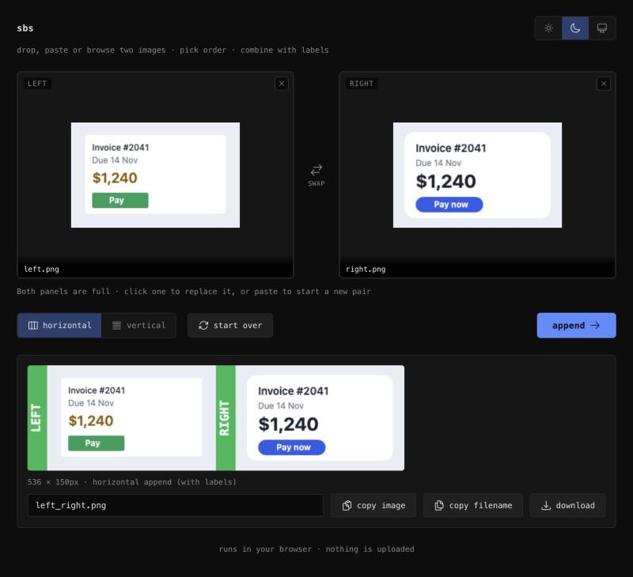

# sbs

Put two screenshots side by side in one image, each marked LEFT or RIGHT, so a model can tell which is which.

## When it helps

When a model gets something visual wrong, you end up describing it in words: "the gap is too big", "the blue is off", "it was fine before". It's slow, and the model has to guess what you mean. Two separate screenshots can also get mixed up. One image with LEFT and RIGHT burned in shows the difference and says which side is which. Paste, point, done.

### The screen doesn't match the design

**Problem:** The model built the page, but the spacing, colours and corner radius are off from your design. Listing every difference takes a paragraph, and it still misses one.

**With sbs:** Paste the model's screenshot and the design. LEFT is what it built, RIGHT is the design. Ask: "Make LEFT match RIGHT."

### The model keeps fixing the wrong thing

**Problem:** You said "the header looks off". It changed the font. You explain again and it changes the padding.

**With sbs:** Put the header as it is on the left and the header you want on the right. The model sees the exact difference instead of guessing which "off" you meant.

### It looks right in one browser and wrong in another

**Problem:** Chrome is fine, Safari or a phone is not. "The card looks squished" doesn't say where.

**With sbs:** LEFT is the broken browser, RIGHT is the good one. Ask what differs and to make LEFT behave like RIGHT.

### A chart, diagram or slide drifted from the template

**Problem:** The model produced a chart or slide from your template, but the legend moved, an axis changed or the order is wrong.

**With sbs:** LEFT is its output, RIGHT is the template or a version you approved. Ask it to follow RIGHT.

### It worked yesterday

**Problem:** After a change the page looks different and you can't say what changed.

**With sbs:** LEFT is now, RIGHT is a screenshot from before. Ask the model to find what changed and bring back RIGHT's look.

## Use it

**Open the page:** https://pyfork.github.io/sbs/

1. Click the panel you want to fill, LEFT or RIGHT. It gets a blue outline, and the line under the panels says where paste goes. Then paste a screenshot (⌘V or Ctrl+V). You can also drop an image on a panel or press **browse** to pick a file. With nothing picked, paste fills LEFT first, then RIGHT.
2. Pick horizontal or vertical. Press swap if the order is wrong.
3. Press **append**, then **copy image** and paste it into your chat. **download** saves a PNG instead.
4. Press **start over** to clear both panels. Pasting a third image also starts a new pair. To replace just one side, click that panel and paste.

The three icons at the top right switch between light, dark and your device settings.

No install, no account, and nothing is uploaded. It runs in your browser. To use it offline, save [index.html](index.html) and open it.

## Tell the model which side is which

The bars say LEFT and RIGHT in both layouts. When the images are stacked, LEFT is the top panel and RIGHT is the bottom one. Say what each side is in your ask:

> LEFT is what you built. RIGHT is the reference. Go with the reference.

Pasted them the other way round? Swap the words in the ask.

## Limits

- Both images are scaled to the same height (side by side) or the same width (stacked), so the smaller one is enlarged.
- Browsers cap canvas size. If the combined image is too big, the page says so. Shrink the images and try again.

## License

[MIT](LICENSE). Icons are [Heroicons](https://heroicons.com) by Tailwind Labs, also MIT.
